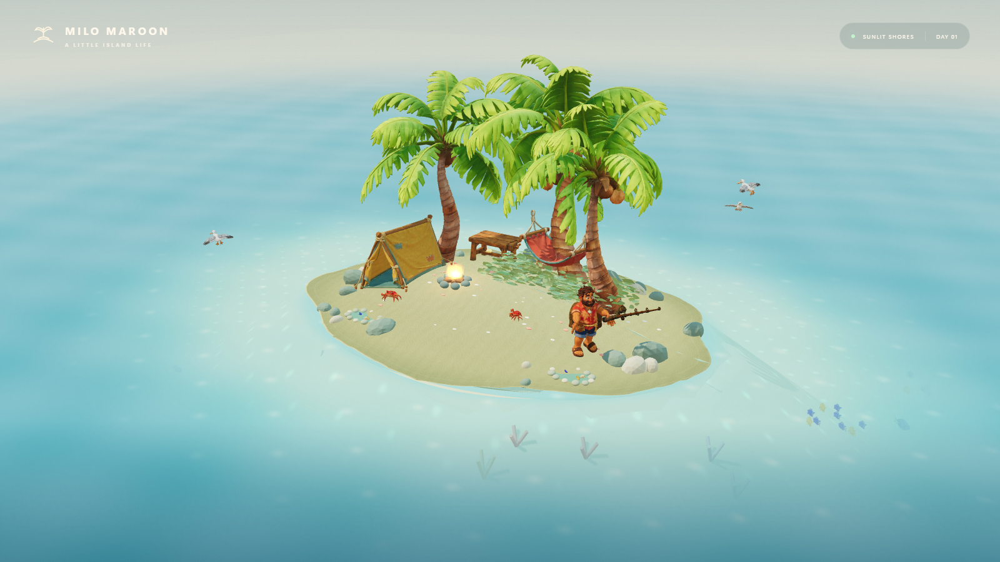
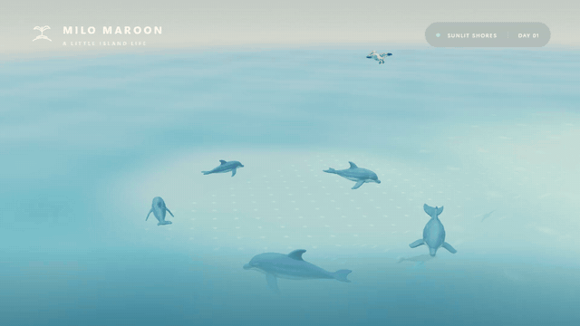
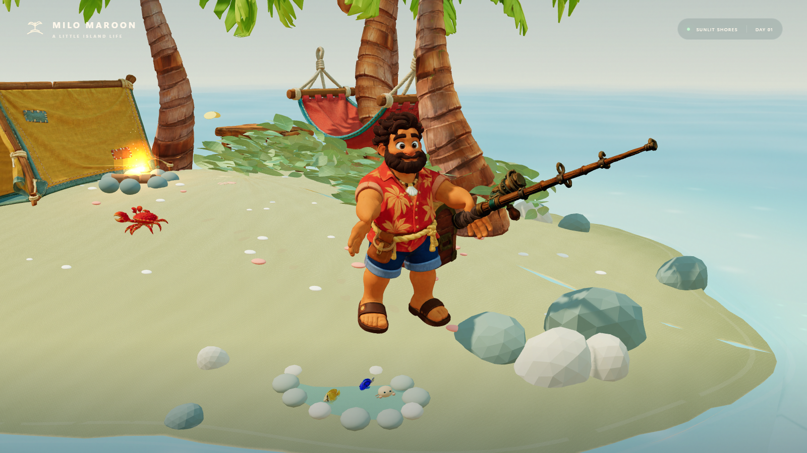
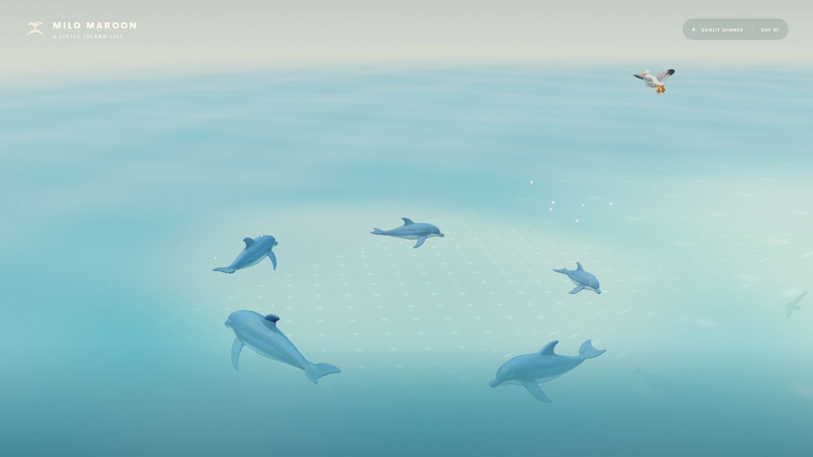
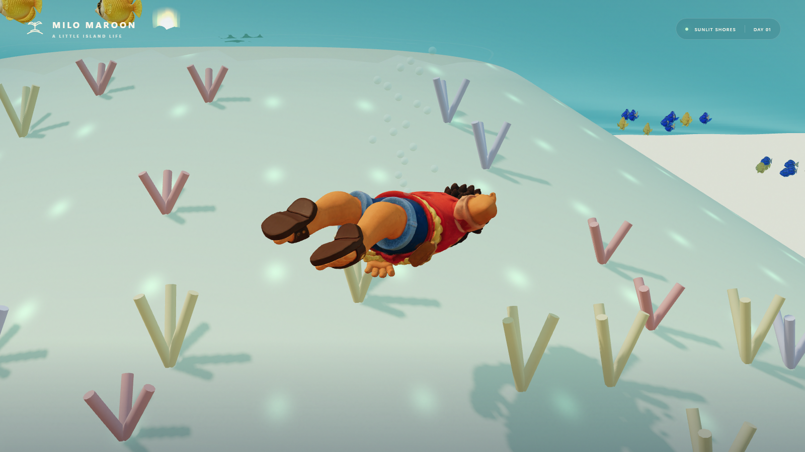
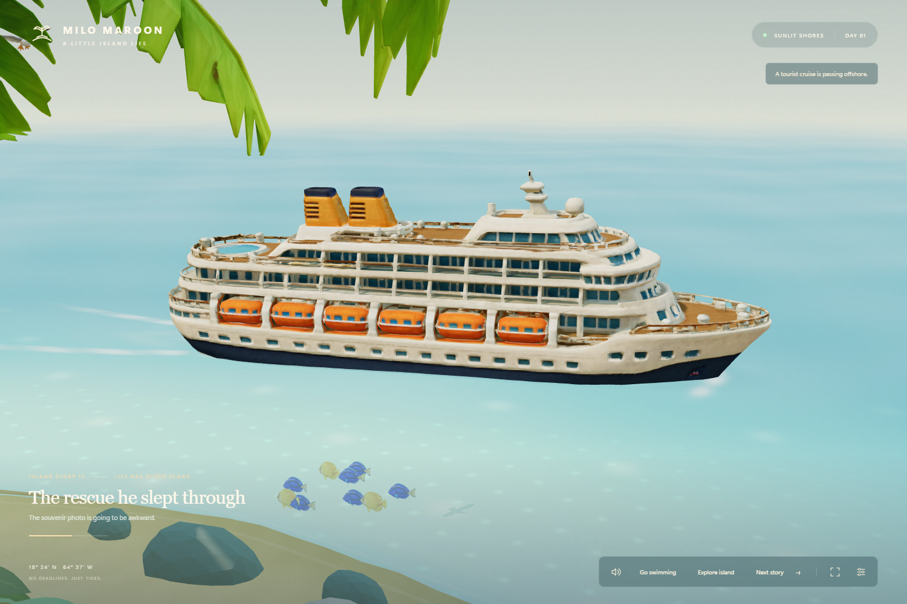

<div align="center">

# Milo Maroon
### A Little Island Life

**A castaway. A tiny island. An unreasonable number of ways to miss a rescue.**

[Download for Windows](https://github.com/Cyrusbrands/milo-maroon/releases) · [How it began](docs/THE-STORY.md) · [Contribute](CONTRIBUTING.md) · [Roadmap](ROADMAP.md)



**Windows x64 · 75 activities · Offline after installation · No account or subscription to run**

</div>

Milo Maroon is an original 3D island screensaver inspired by the charm of **Johnny Castaway**. Milo fishes, cooks, gardens, builds questionable inventions, befriends animals, swims, and sometimes sleeps through a passing cruise ship.

The island has room to breathe. Milo can simply look around. Birds and fish arrive, change direction and leave again. Dolphins play offshore. A seabird might dive for lunch. A rare visitor might appear while you are watching somewhere else.

This independent project has its own character, code and assets. It is unofficial and unaffiliated with the original Johnny Castaway creators.



## Watch the island

| Milo at home | Company from the reef |
|---|---|
|  |  |

| Below the surface | Ships on the sea |
|---|---|
|  |  |

These are application captures. Images in the development story include an earlier prototype and a generated character reference; those are labeled separately.

## Download and run

1. Open [Releases](https://github.com/Cyrusbrands/milo-maroon/releases).
2. Download **Milo-Maroon-0.15.1-USB-Offline.zip** for the complete offline installer, or **Milo-Maroon-0.15.1-Windows.zip** if WebView2 is already installed.
3. Extract the **entire ZIP** to a normal folder. Do not run it inside the archive.
4. In the offline package, run **Install.cmd**. In the portable package, run **Start.cmd**.

Requires Windows 10 22H2 / Windows 11, Intel/AMD x64, and hardware-accelerated WebGL. The .NET runtime is included. The offline installer also includes Microsoft's WebView2 installer. The portable download needs WebView2 already installed. This preview supports the primary monitor only; Windows ARM64 is not supported.

The application is currently **unsigned**. Windows may show a reputation warning. Use the published checksums and source to assess the download. Do not disable security software to run it.

You can enjoy the normal application without registering a screensaver. No WSL, Tripo account, model API key or paid AI subscription is needed during playback.

## Make yourself at home

Start with **Follow the sun**, **Cinematic** pacing, **Lively island**, sound around **25–35%**, and music off. Use Beautiful graphics if your computer stays smooth. A fixed camera and disabled camera movement give a quieter view.

- **Explore island** previews residents, visitors, swimming and bird fishing.
- **N** finds another activity; **Space** pauses; **F** toggles fullscreen; **C** cycles camera direction.
- **Escape** closes panels/fullscreen. Mouse movement or a key exits screensaver mode after its startup grace period.
- **Follow the sun** cycles a simulated island day, rather than matching your wall clock or local sunrise.

Quiet spells are intentional. Preview controls invite a moment; they do not represent its normal frequency.

## What lives here?

- **Milo:** 75 authored activities guided by needs, recent history, weather, novelty and cooldowns.
- **Captain Claw, Pebble and Inspector Peake:** recurring animal companions with their own roles.
- **A living reef:** independently moving fish schools, returning bird flocks, fishing dives, dolphin families, sharks and turtles.
- **Visitors:** sailboats, a cruise ship, pirates, an aircraft, whale, UFO and rare mermaid encounters.
- **A changing campsite:** gardening, inventions, friendships, footprints and weather aftermath.
- **A local soundscape:** recordings and synthesized effects tied to position, scene and activity.

This is a local behavior simulation, not an LLM inventing new stories at runtime. Authored activities combine with persistent state and randomized scheduling. Life does not advance while the app is closed.

## How it began

I wanted the feeling of an old screensaver back: the pleasure of watching an ordinary little character do something unexpectedly funny.

The first question was simple: **could Johnny Castaway's spirit become a modern 3D island?** Then came the real questions. Could he fetch a laptop from his tent? Could he miss a tourist cruise because he was asleep? Could the animals have lives of their own? Could doing nothing sometimes be the best thing to watch?

Milo grew through those questions, many prototypes, and very specific bug reports: disappearing hands, swimming on sand, sharks through the beach, birds trapped in circles, and ships traveling stern-first.

[Read the full illustrated story →](docs/THE-STORY.md)

## Built with a human, code and AI tools

Created and directed by **[Cyrusbrands](https://github.com/Cyrusbrands)**, with AI-assisted programming through **Codex**, AI-assisted visual references and **Tripo-generated 3D models**, followed by local preparation, rig adaptation and in-engine animation. The owner supplied the direction, paid asset-generation subscription, testing feedback and recordings. [Workflow and credits](docs/ASSETS-AND-LICENSES.md).

This is an evolving preview. Some intersections, poses and transitions still need polish. Its collisions and water behavior are purpose-built approximations, not a full physics or motion-capture system. [Known limitations](docs/KNOWN-LIMITATIONS.md).

## Build and contribute

```sh
npm ci
npm run assets
npm run check
npm test
```

For a browser preview, run `npm run dev` and open http://localhost:8080. Windows builds additionally need the .NET 10 SDK: run `powershell -NoProfile -ExecutionPolicy Bypass -File Build.ps1`. [Detailed setup](docs/DEVELOPMENT.md).

Large models live in a versioned release asset instead of Git history. `npm run assets` downloads and verifies their hashes. The complete application downloads already include them. Simpler procedural fallbacks remain available where supported.

Animation, accessibility, performance, audio balance, bug reproduction and new island stories are all useful contributions. Please preserve offline operation, quiet moments and rare surprises. [Start contributing →](CONTRIBUTING.md)

## License and credits

Original code is **MIT**. Project-owned generated models and project imagery use a separate **CC BY 4.0** grant to the extent applicable rights are held. Recordings and libraries keep their own licenses; Pixabay sounds are **not relicensed under MIT or CC BY**. See [asset credits](docs/ASSETS-AND-LICENSES.md) and [third-party notices](THIRD-PARTY-NOTICES.md).

If this little island makes you smile, a star helps other people find it. Bug reports and thoughtful contributions help it grow.
