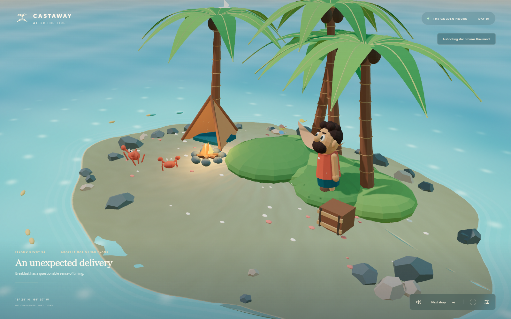
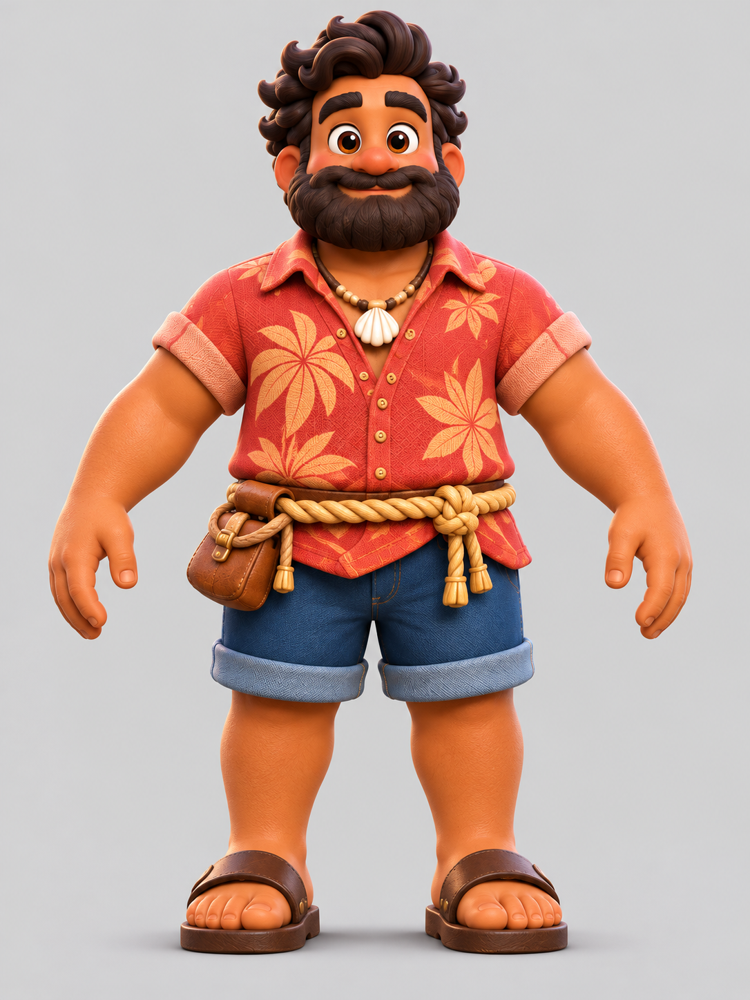
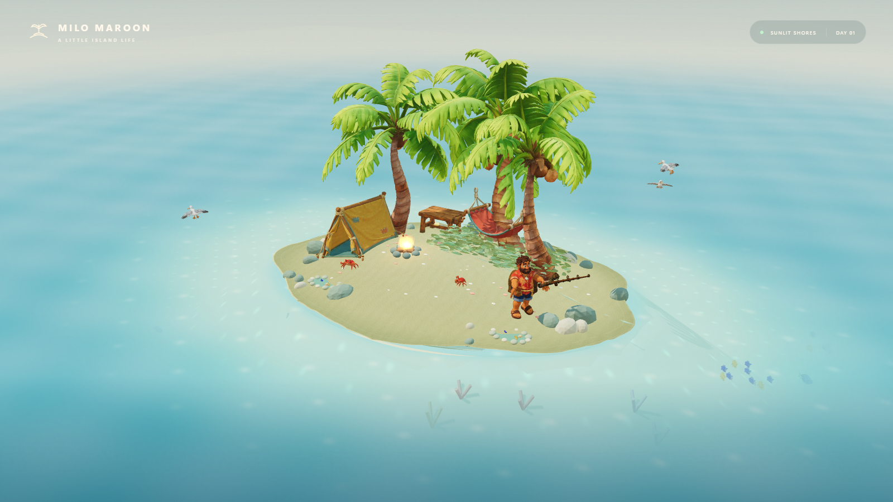

# From an old screensaver to Milo Maroon

*The development story, told from the creator's perspective and based on the actual project conversations, prototypes and test records.*

## An idea hiding in an old folder

This did not begin with a polished game pitch. I was exploring a reverse-engineering tool and an old Johnny Castaway screensaver installer. I wanted to understand what I had and why it installed differently.

Then curiosity became another question: could we build a modern screensaver with that same sense of life?

The appeal was never a score or a progression bar. It was the possibility that, if you watched for a little longer, something funny might happen. I wanted that feeling in an original world with modern 3D graphics and sound.

## The first island

The first direction was a stylized 3D adventure: a tiny tropical island, a castaway, palms, a tent, a campfire and an ocean around it. The early prototype was called Castaway: After the Tide.

There was already a lot to like. But I did not want a short animation endlessly looping. I wanted to sit down and discover things.

What if he went into his tent and came out with a laptop? What if he went snorkeling and met a shark? What if a tourist cruise passed while he was asleep?

Some requests were practical. Some were deliberately ridiculous. That mix became part of the island's personality.

## The important upgrade was doing less

At first, making the island entertaining seemed to mean adding more events. Then constant entertainment became its own kind of repetition.

I wanted him to stand still sometimes. Look around. Wait. I wanted the camera to stop changing so often, and the cruise ship to stop appearing so frequently.

That feedback changed the direction: quiet intervals, longer cooldowns, a patient camera and surprises without an obvious timetable. An ordinary moment gives the next strange one somewhere to land.

## Giving him a name and a face

The project needed its own identity. The castaway became **Milo Maroon**, alongside Captain Claw the crab, Pebble the turtle and Inspector Peake the seabird.

Character sheets helped define the art direction. Later, we revisited Milo again: a friendly bearded castaway in a Hawaiian shirt, denim shorts, sandals and a rope belt.

A beautiful image was only the beginning. It was not a rigged, expressive 3D character just because it looked like one.

## Building the cast, one upload at a time

The workflow became a back-and-forth: create a reference, upload it to Tripo, generate and prepare the model, inspect it, then integrate it. I bought a paid subscription and credits to keep improving the cast.

Milo, dolphins, sharks, seabirds, palms, turtles, Captain Claw and the tent were followed by boats, a whale, reef fish, parrot, hammock, chest, workbench, pot, raft, rod, aircraft, UFO and mermaid.

Adding a model does not finish an asset. Every instance needs the right scale, orientation, placement and role. Replacing one turtle while another keeps its old appearance is not a complete upgrade.

## The screenshots that made it better

The bug reports were often an image and a question.

Why is he swimming on sand? Why are his hands tiny? Where did his arm go? Why does the shark fin cut through the beach? Why does that boat seem to hover?

Each report exposed something different: bone directions, rig adaptation, clearance around props, shoreline depth, transitions, waterlines or a model's forward axis. Fixing them needed code and verification, not just more polygons.

We added pose and hand-visibility checks, shared water coordinates, clearer transitions and focused previews. The checks help catch regressions. They do not make every possible interaction perfect.

## An island that listens

A loud ocean loop can overpower the small sounds that make an island feel alive. Sound needed restraint as much as the camera did.

I collected recordings, named them by their intended role and supplied them for integration. They were measured, shortened and compressed into small reusable effects and loops. An aircraft should not leave its full recording playing after it has gone. A cruise horn belongs to the ship, not an unrelated moment later.

Recorded ambience now mixes with original synthesized effects. Sounds follow positions, activities and visitors. The original Pixabay download-page information was not retained for every supplied recording; those gaps are documented rather than filled with invented credits.

## A world beyond Milo

The next repeated pattern was wildlife. Birds went the same way every day. Fish traced the same circles.

Those paths became persistent movement with changing destinations, arrivals, departures and quiet intervals. Sometimes a seabird approaches a fish, dives, splashes, scatters the school and climbs away. Sometimes it misses.

Another screenshot showed a cruise moving one way while its bow faced another. Ships now align their bows with travel, sit in the sea, follow the rendered wave field and leave wakes behind them.

## Why share it?

I want people to download Milo, watch the island and help improve it. A funny new moment, cleaner animation, accessibility fix or well-explained bug report can all make it better.

This is not a story about making everything perfectly in one prompt. It is a story about a small idea, many iterations, AI-assisted tools, and continuing to ask whether what is on screen actually feels right.

Milo still has things to learn. I hope other people will help teach him.

— **Cyrusbrands**
